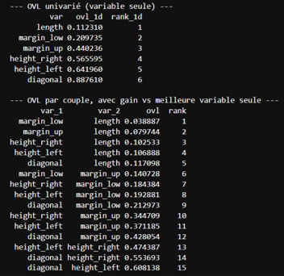
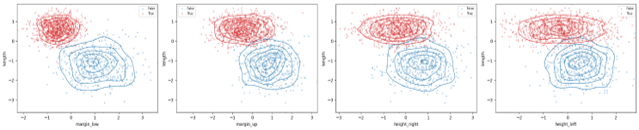
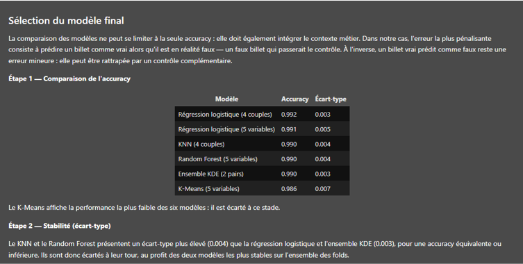

# Détection de faux billets

Python · scikit-learn · Machine learning · Formation

Construction et comparaison de modèles de classification pour distinguer les vrais billets des faux à partir de leurs mesures géométriques, avec une méthode de sélection de variables développée sur mesure et un modèle déployable.

## Contexte

Ce projet a été réalisé dans le cadre de ma formation de Data Analyst chez OpenClassrooms. L'objectif : construire un algorithme capable de détecter automatiquement les faux billets à partir de six mesures (diagonale, hauteurs gauche et droite, marges haute et basse, longueur).

Le jeu de données contient 1 500 billets, dont 37 comportent des valeurs manquantes. Les 1 463 billets complets se répartissent en 971 vrais et 492 faux.

Le critère métier central : **ne jamais laisser passer un faux billet**. Le modèle est donc jugé en priorité sur sa capacité à détecter les faux.

## Démarche

1. **Analyse exploratoire**
   - Comparaison des distributions des variables par classe
   - Hypothèse : certaines variables, et certaines paires de variables, séparent mieux les classes que d'autres

2. **Mesure du pouvoir discriminant (coefficient de recouvrement, OVL)**
   - Standardisation (z-score), estimation de la densité de chaque classe par KDE sur une grille commune, puis calcul du recouvrement entre les deux densités
   - Application aux 6 variables seules et aux 15 paires de variables
   - Résultat : la variable `length` est la plus discriminante seule (11 % de recouvrement), `diagonal` la moins (88 %). **Quatre paires font mieux que la meilleure variable seule.**

3. **Protocole de comparaison** sur trois jeux de variables :
   - la meilleure variable seule (référence)
   - les 4 paires identifiées (5 variables)
   - toutes les variables

4. **Modélisation**, avec validation croisée stratifiée en 5 folds :
   - régression logistique
   - K plus proches voisins
   - Random Forest (exploration des hyperparamètres puis grid search, avec `min_samples_leaf ≥ 4` pour limiter le surapprentissage)
   - K-Means (non supervisé, après validation de l'existence de deux groupes par la silhouette et l'inertie)
   - **un modèle KDE par paires**, développé sur mesure

5. **Sélection du modèle final** en trois étapes : accuracy, stabilité entre les folds, puis recall de la classe « Faux » (critère métier)

6. **Sauvegarde et déploiement** : pipeline complet (standardisation et modèle) sauvegardé avec Joblib, puis rechargé dans un second notebook qui prédit sur de nouveaux billets et gère les lignes incomplètes

## Résultats

- Une variable seule donne environ **95,6 %** d'accuracy. Combiner les bonnes paires de variables fait passer le résultat à **99 %** environ.
- **Régression logistique (4 paires) : 99,2 %**, **ensemble KDE (2 paires) : 99,0 %**, KNN et Random Forest à peu près au même niveau
- **K-Means** atteint 98,6 % sans jamais voir les étiquettes : les vrais et les faux billets forment deux groupes naturels bien séparés
- Le **modèle KDE par paires** est retenu comme modèle final, car il détecte le mieux les faux billets : environ **98,8 % des faux** sont repérés, contre 98,2 % pour la régression logistique
- La régression logistique est conservée comme second pipeline, plus simple à expliquer et à maintenir

## Aller plus loin : analyses complémentaires

- **Sélection de variables par l'OVL** : une méthode statistique construite sur mesure (densités 2D par KDE sur grille commune, avec réflexion sur le choix de la bandwidth) pour classer les paires de variables avant toute modélisation
- **Modèle KDE par paires** : un classifieur compatible scikit-learn (`BaseEstimator`, `ClassifierMixin`) développé pour exploiter les deux paires les plus discriminantes, avec des grilles de probabilités précalculées pour une prédiction rapide
- **Comparaison à protocole constant** de cinq familles de modèles sur trois jeux de variables, pour mesurer l'apport réel de la sélection de paires
- **Sélection du modèle guidée par le risque métier** : accuracy, stabilité, puis recall de la classe « Faux », plutôt que l'accuracy seule
- **Analyse des hyperparamètres du Random Forest** par courbes de validation et garde-fou contre le surapprentissage
- **Déploiement reproductible** : pipeline Joblib, détection des lignes incomplètes et prédiction uniquement sur les lignes valides

## Réalisations

**Coefficient de recouvrement (OVL) entre deux classes (Python)**

```python
def compute_ovl(X0, X1, grid_size=150, bw_method=None):
    """Score entre 0 (séparation parfaite) et 1 (superposition totale)."""
    pts = np.vstack([X0, X1])
    xx, yy = np.meshgrid(
        np.linspace(pts[:, 0].min(), pts[:, 0].max(), grid_size),
        np.linspace(pts[:, 1].min(), pts[:, 1].max(), grid_size))
    grid = np.vstack([xx.ravel(), yy.ravel()])

    p0 = gaussian_kde(X0.T, bw_method=bw_method)(grid)
    p1 = gaussian_kde(X1.T, bw_method=bw_method)(grid)
    p0, p1 = p0 / p0.sum(), p1 / p1.sum()

    return np.minimum(p0, p1).sum()   # aire commune des deux densités
```


*Pouvoir discriminant des paires de variables (OVL)*


*Densités des vrais et faux billets pour les paires les plus discriminantes*


*Comparaison des performances des modèles (moyenne sur 5 folds)*

## Limites et perspectives

- Les billets aux valeurs manquantes sont écartés (37 sur 1 500) : une imputation permettrait de les classer aussi
- Les paires de variables ont été choisies sur l'ensemble des données, avant le découpage en folds
- Les performances sont mesurées par validation croisée, sans jeu de test totalement isolé
- Mise en place possible d'un seuil de décision ajustable pour renforcer encore la détection des faux

## Stack

`Python` · `pandas` · `scikit-learn` · `scipy` · `seaborn` · `joblib` · `Jupyter`

[Voir le projet complet sur GitHub →]()
[Retour à la liste de projets →]()
